# ui-creator

A Claude Code plugin for improving the interface of an application that already exists. It audits the UI against UX and accessibility rules, suggests contrast-checked color palettes for the product's domain, lists the component sources you can use, and applies changes token-first while checking that application logic was left alone.

Status: early development, unpublished. All seven commands are written. `palette`, `audit` and `element` have been run as plugin commands; `explore` and the browser verification flow have been walked through by hand on a sample app; `page`, `overhaul` and `sources` have not been run as plugin commands yet.

## See it work



The animation is an illustration of the flow, drawn after a real session on a small sample invoicing app (React, Tailwind): pick an element on the page, see it on its own with its variations beside it, apply the one you like.

### Variations, live in your own app

Ask for alternatives to a page or a component and they appear in the browser, wired to your real data and handlers. The bar at the bottom switches between your current design and each draft. In the session above, one round was asked for with the note "more futuristic" and came back as an instrument panel, a lit rail and a night panel.

What a round gives you:

- **Three or more drafts on one axis.** Each round varies one thing (layout, density, emphasis, a design language) and says which, so the drafts are comparable and not three unrelated redesigns.
- **Steering in your own words.** Type a note such as "more futuristic" or "like B but with badges" and press New variations; the next round follows it.
- **Your logic stays put.** Drafts receive the same props and handlers as the current component; state, data fetching and routing are not touched.
- **No invented content.** Drafts rearrange and restyle what is there. They do not add fake charts, numbers or features.
- **Checked, not just drawn.** Text contrast is measured, and the chosen draft is viewed with long text, missing data and at phone width before it is kept.

### Compare on real rows

A component that appears many times can show a different draft on each instance, so you compare them in place, next to each other, on real content: four rows of a table, each showing a different draft of the same cell.

With several comparisons open there is still one bar. Its scope selector says what a click applies to: all of them together, or one component set apart ("page C, table A").

### Design languages

The Style window previews twelve design languages. Pick one, mix two, or describe your own in a sentence; the drafts come back in that language using your project's own colors.



| Language | In short |
|---|---|
| Glassmorphism | Translucent frosted panels floating over a colorful or photographic background. |
| Neumorphism | Soft shapes pressed out of, or into, a single-color surface. |
| Claymorphism | Puffy, rounded, toy-like blocks with inner highlights. |
| Neo-brutalism | Thick black outlines, hard offset shadows, flat loud colors. |
| Minimal / flat | Mostly whitespace and type; hairlines where a line is needed, nothing decorative. |
| Material | Paper-like surfaces at clear elevation levels, filled primary actions, tonal color. |
| Bento grid | Content in rounded tiles of different sizes that lock into one grid. |
| Editorial | Looks like a well-set magazine: serif headlines, rules, generous margins. |
| Dark neon | Near-black surfaces with glowing accent lines and text. |
| Soft pastel | Light tinted surfaces, big radii, gentle colored shadows. |
| Corporate clean | Calm, dense, predictable: the look of dependable business software. |
| Terminal / mono | Monospaced type, boxes drawn with lines, the feel of a console. |

A style describes shape (surface, edge, depth, corners, type), not color. Where a style and an accessibility rule conflict, the rule wins and the style is adapted; styles that are known to be hard on contrast are marked in the window.

### Everything from the browser

With the local listener running you do not need to go back to the chat:

- **Pick element:** click anything on the page to start a comparison for it. If the area holds other components, you choose on the page which of them to include.
- **Phone view:** opens the current draft at 375px.
- **Save:** keeps a draft in your personal library for other projects.
- **Apply:** two clicks; the draft becomes the component and the temporary code is removed.
- **Close:** ends a comparison and keeps your current design. The dock menu can close all of them at once, or start a comparison for the whole page.
- **Settings:** the tool's own look (dark or light, four accent colors), kept in your browser.

## Commands

| Command | What it does |
|---|---|
| `/ui-creator:audit [path]` | Reports findings by severity. Changes nothing. |
| `/ui-creator:palette <domain>` | Offers palettes for a domain (English or Turkish names) with WCAG contrast results, then applies the chosen one as tokens. |
| `/ui-creator:sources` | Lists installed UI skills, the project's libraries and registries, and a catalog of shadcn registries; saves your selection. |
| `/ui-creator:element <component>` | Improves one component. |
| `/ui-creator:page <route>` | Improves one page. |
| `/ui-creator:library` | Saves designs you like to a personal library outside the project and reuses them in other projects. |
| `/ui-creator:overhaul` | Reworks the whole app in phases, stopping for approval. |
| `/ui-creator:explore <element>` | Shows layout alternatives for one element live in the browser, side by side, and applies the one you pick. A bar in the page switches drafts, opens a phone view, and (with a local listener) removes, requests, saves and applies drafts without typing in chat. Picking an area that holds other components asks, on the page itself, which of them to include. A Style window previews twelve design languages (glassmorphism, neo-brutalism, bento and others); pick one, mix two, or describe your own, and the drafts come back in that language using your project's colors. Comparisons work on React 16.8+ (including Next.js), Angular 12+ (NgModule or standalone), Vue 2.6+ and Svelte 3+; the element picker dock works on any framework with a module bundler. While a comparison is open, a local commit check keeps the temporary code out of your history. |

The `ui-core` skill loads automatically for UI work and holds the rules, data and scripts the commands share.

## Requirements

- Node.js 18 or later. The scripts have no dependencies.
- Git, for the check that a styling pass did not change logic.

## Install

In Claude Code 2.1.275 or later:

```
/plugin install ui-creator --marketplace murtazayucal/ui-creator
```

To try a local checkout without installing:

```
claude --plugin-dir /path/to/ui-creator
```

## Evals

`evals/` holds cases for `claude plugin eval`, which runs each case with and without the plugin. See `evals/README.md` for the cases, the last results and the limits.

## What it keeps in your project

- `design-system/MASTER.md`: the design record every command reads first.
- `design-system/pages/<page>.md`: page-specific exceptions.
- `design-system/sources.json`: the component sources you chose.

## Data

- 275 color palettes from ui-ux-pro-max-skill, tweakcn, daisyUI and Catppuccin, with recomputed WCAG contrast. See `skills/ui-core/data/THIRD_PARTY_NOTICES.md`.
- A snapshot of the public shadcn registry index.
- Rebuild with `node tools/fetch-sources.mjs`, `node tools/build-palettes.mjs` and `node tools/build-registries.mjs`.

## Limits

- The audit's static scan is pattern-based. A clean result means no automatically detectable issues were found, not that the UI is accessible.
- Domain-to-color suggestions are conventions with stated evidence levels, not psychological facts.

## License

MIT. Bundled palette data keeps its original licenses.
